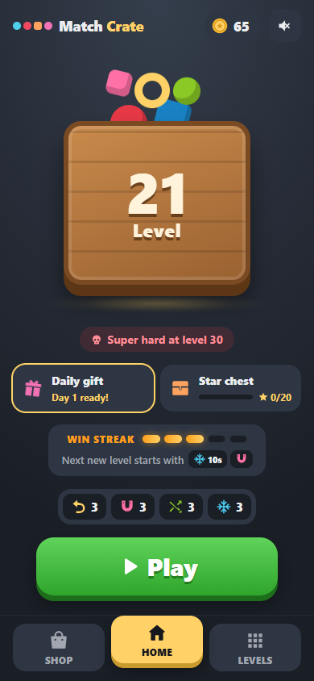
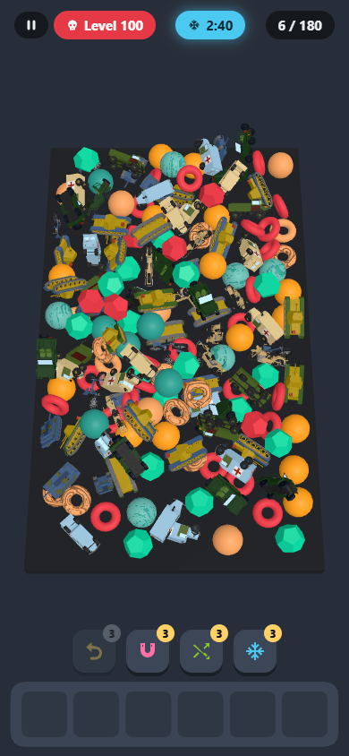
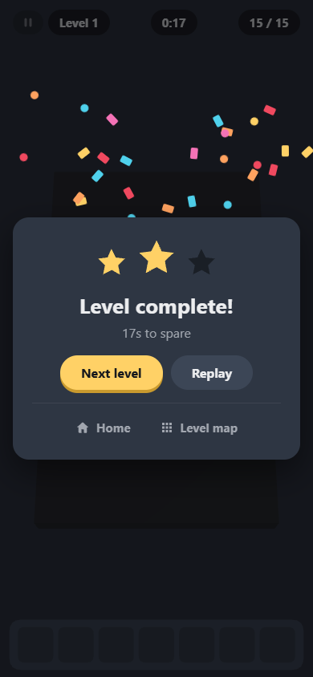

# Match Crate

**Find order in the chaos.** A 3D matching puzzle for the browser: tap items out of a
physics-driven pile and collect them in threes before the tray fills up or the clock runs out.

**▶ Play it: [match-crate.vercel.app](https://match-crate.vercel.app)**. It works on phones and
desktops, and you can install it to your home screen to play offline.

<p align="center">
  
  
  
</p>

## How to play

- Tap an item in the pile to send it to the tray. Three of a kind merge and clear.
- Clear the whole pile to win. You lose if the tray fills up (7 slots, 6 on super hard
  levels) or the timer hits zero.
- Finishing with more time left earns more stars: 3 for half the time or more, 2 for a
  quarter or more, otherwise 1.

## Features

- **Endless levels.** Levels 1–100 are hand-tunable JSON. Every level after that is
  generated from its number, so it's the same for everyone. Every 5th level is *hard*
  and every 10th is *super hard*.
- **Level map.** A winding road of level bubbles, 100 per chapter.
- **Boosters:**
  - Undo puts the last item back.
  - Magnet pulls in a full set of three.
  - Shuffle tosses the pile.
  - Freeze stops the clock for 10 s.
- **Win streak.** Winning new levels in a row gives the next one a head start: up to
  15 s of frozen clock and 2 sets pulled in automatically.
- **Coins:**
  - **Earned** from new stars, hard levels, a 7-day daily gift and a star chest every
    20 stars.
  - **Spent** in the shop, or on a *continue* (+30 s, or three tray items back on the
    pile) that costs more each time you use it in the same attempt.
- **Installable app.** It has a web app manifest and icons, and a service worker caches
  the game so it opens instantly and works offline.
- **Feel:** spark bursts on matches, confetti on wins, and vibration on Android. Sound
  effects and a light music loop are all synthesised with Web Audio, so there are no
  audio files to download.

## Tech

React 18 · [react-three-fiber](https://github.com/pmndrs/react-three-fiber) + drei ·
three.js · [Rapier](https://rapier.rs) physics (`@react-three/rapier`) · zustand · Vite 5 ·
Vitest · Vercel

Some of the work that keeps it light and smooth with up to 180 physics bodies on a phone:

- **Rendering:**
  - **Instancing:** one instanced mesh per item type.
  - **Physics sleep:** the pile is put to sleep once it settles, so a calm pile costs
    almost nothing to simulate.
- **Small downloads:**
  - **Models:** the low-poly vehicles are compressed with meshoptimizer, quantised, and
    stripped of normals. Flat normals are rebuilt at load time.
  - **Lazy 3D:** the menus are plain HTML. three.js and the physics engine load as a
    separate chunk while you're on the home screen.
- **Shaders:** a two-tone stripe shader (`onBeforeCompile`) textures items with small
  black-and-white WebP stripe images. Hover outlines are an inverted hull extruded along
  smoothed normals.
- **Tray:** it's an orthographic HUD scene, so every slot looks identical. Items fly from
  the pile in a camera-matched overlay, and merges are driven by landings, not timers.
- **Adaptive quality:** the render resolution steps down when frames drop and back up when
  there's headroom, and the game remembers the setting for next time.
- **Deterministic levels:** a seeded random number generator (mulberry32) means a level's
  pile is the same on every play.

## Getting started

```bash
npm install
npm run dev       # dev server
npm test          # game rules + level data (Vitest)
npm run build     # production build in dist/
npm run preview   # serve the build (the service worker only runs in builds)
```

Dev shortcuts: `?level=37` jumps straight into a level, and `?debug` adds orbit controls and
the physics debug view.

## Project layout

```
public/
  assets/levels/levels.json   levels 1–100
  assets/models/              low-poly vehicles (.glb, meshopt)
  assets/textures/            stripe textures (.webp)
  manifest.webmanifest, sw.js, icons/   installable app
src/
  components/                 menus, HUD, sheets, effects (HTML/CSS)
  world/                      3D scene: pile, tray, camera, outlines
  utils/
    store.js                  game state and rules (zustand)
    levels.js                 difficulty, item caps, level loading
    levelGen.js               generator for levels past 100
    economy.js                coins, boosters, streak, daily gift, star chest
    storage.js                save data (localStorage, with migrations)
    sfx.js                    synthesised sound, music and vibration
tests/                        Vitest: rules and level data
```

### Tuning

- **Difficulty:** `DIFFICULTY` in `src/utils/levels.js` sets the time limit share, item
  multiplier and tray sizes for every level.
- **Economy:** every price, reward and streak stage lives in `src/utils/economy.js`.
- **Levels:**
  - `npm run levels` regenerates levels 1–100. The tests check that the committed
    `levels.json` matches the generator.
  - `npm run models` re-optimises the vehicle models.

## Deployment

Hosted on Vercel and connected to this repo: every push to `main` deploys to
[match-crate.vercel.app](https://match-crate.vercel.app). The build runs `npm test` first
(see `vercel.json`), so a failing test stops the deploy.
